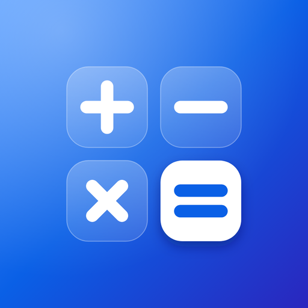
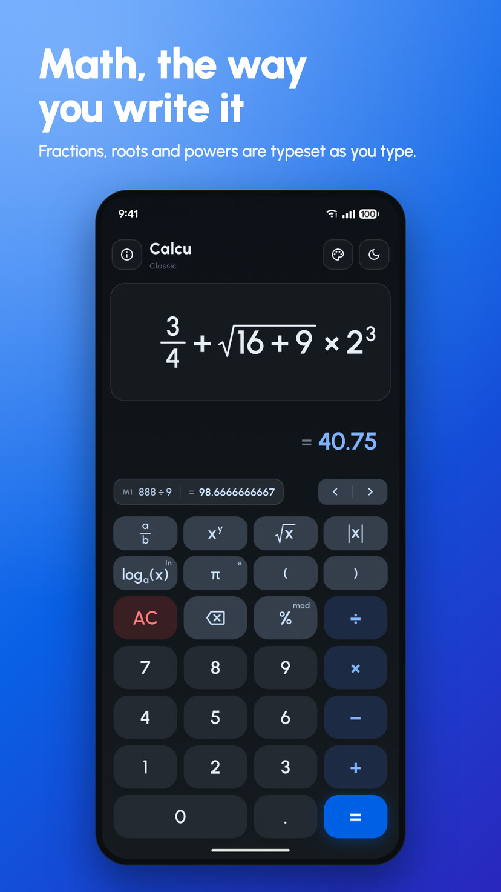
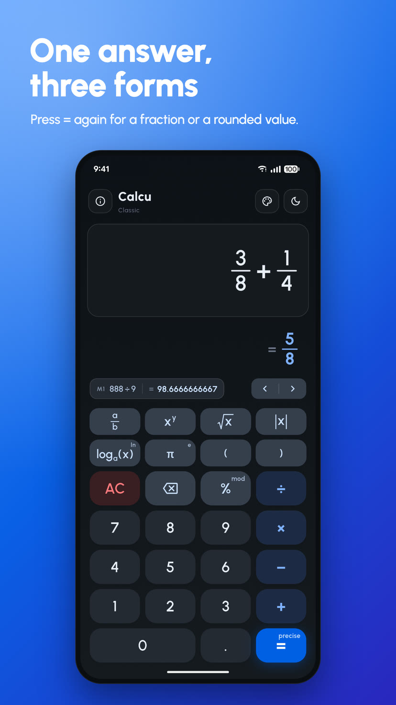
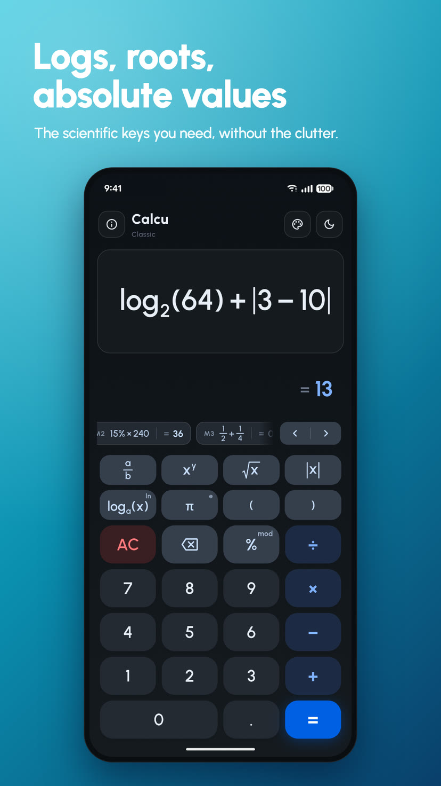
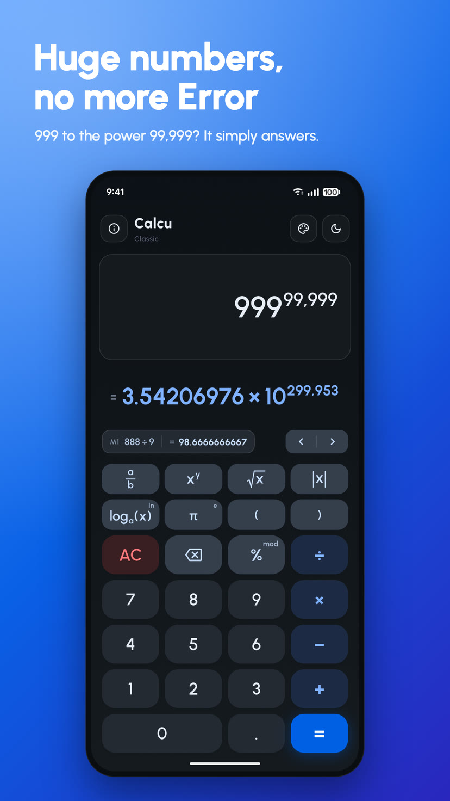
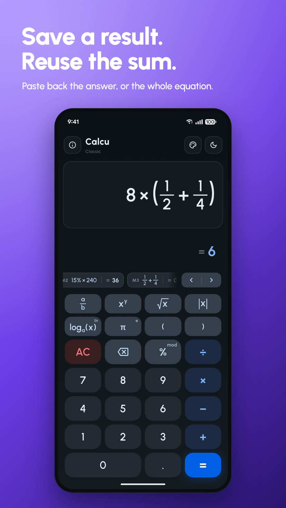
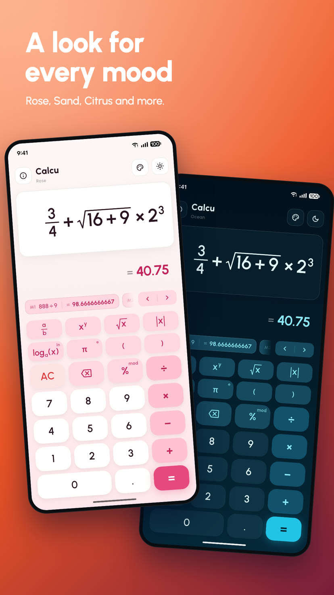

# Calcu

### The calculator that writes math the way you do

 

## 📱 Screenshots

  
  
  
  

  
  
  
  

 

## 📖 Features

- **Natural display.** Fractions stack, exponents rise and roots get their bar as you type, so the screen shows the sum the way it looks on paper. Tap anywhere in it to edit.

- **Three answer forms.** Press `=` again to switch between the decimal, the exact form (a fraction, a root or a multiple of π) and a value rounded to three places.

- **Scientific keys.** Powers, roots, logarithms to any base, natural log, absolute value, percent, modulo, π and e.

- **Huge numbers.** Results far beyond the usual limit are answered in scientific form instead of an error: `999^99999` is about 3.54 × 10^299953.

- **Saved results.** Hold a result to keep it, along with the equation it came from. Tap either half of a saved chip to paste the answer or the whole equation back. Hold a chip to remove it, with a few seconds to undo.

- **Nine themes.** Classic, Rose, Sand and Citrus are free; Midnight, Sunset, Forest, Ocean and Monochrome are premium. Each has a light and a dark side, and you can swipe through a live preview of the calculator in every one before choosing.

- **Handy shortcuts.** Hold `⌫` to keep deleting, hold `%` for mod, hold `log` for ln, hold `π` for e, and hold the info button to clear every saved value.

- No ads.

- Built with [Flutter](https://flutter.dev/), in a [Material Design 3](https://m3.material.io/) style.

## ⬇️ Download

- For most devices, it is recommended to install the **arm64-v8a** version of the apps
- Directly from Playstore: [Google Play Store](https://play.google.com/store/apps/details?id=com.decodersfamily.calcu)
- Download the latest stable version from [GitHub releases](https://github.com/zamansheikh/Calcu/releases/latest)
- Install the [pre-release](https://github.com/zamansheikh/Calcu/releases/) versions to help us test out new features & changes

## 💬 Contact

Join our [Telegram Channel](https://t.me/programmernexus) for discussion, announcements, and releases!

## 💖 Sponsors

  -- No sponsors
  
  -- Calcu Bot will be always a free and open source for everyone. If you like it, please consider [sponsoring me](https://github.com/sponsors/zamansheikh)!

## 💲Donate 

  

## 🤝 Contributing

Contributors are welcome!

	
>**Note**

>For submitting bug reports, feature requests, questions, or any other ideas to improve, please read [CONTRIBUTING.md](https://github.com/zamansheikh/Calcu/blob/main/CONTRIBUTING.md) for instructions and guidelines first.

## 🧱 Credits

Youtube Tutorial 😁

## 📃 License

>**Warning**

>Except for the source code licensed under the GPLv3 license,
>all other parties are prohibited from using Calcu's name for their own app,
>and the same is true for Calcu's derivatives.
>Derivatives include but are not limited to forks and unofficial builds.

<table><td>
<a href="#start-of-content">👆 Scroll to top</a>
</td></table>

